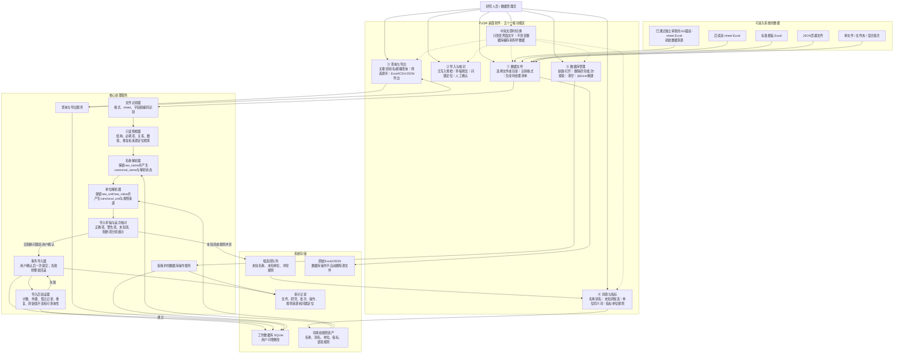
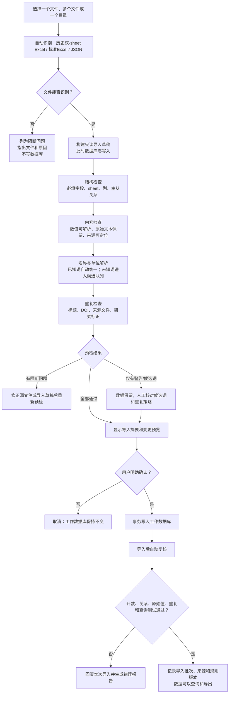
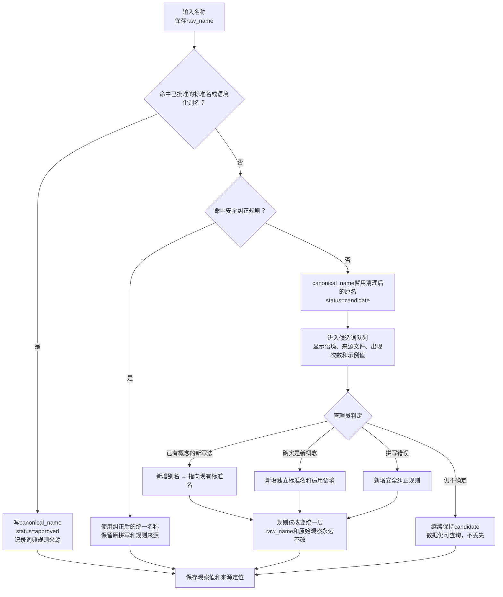
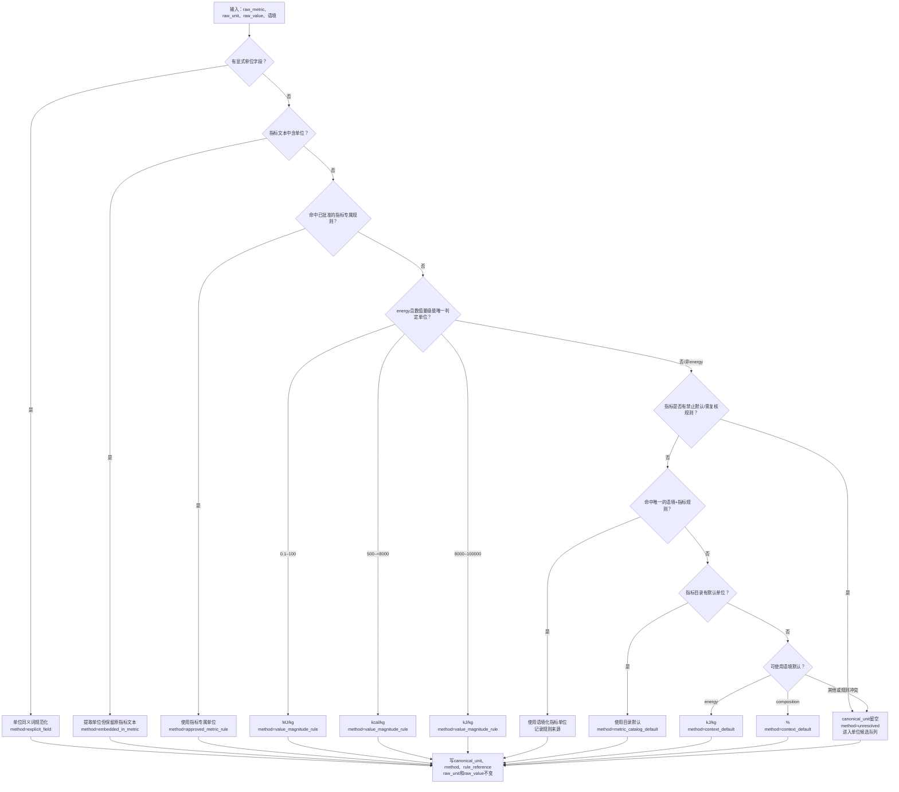

# 历史饲料原料数据库软件系统功能图

> 本图描述软件怎样接收、检查、解析、保存和使用数据，不描述数据仓库发布流程。

## 1. 系统总功能图

## 2. 后续新数据怎样进入系统

### 预检结果分级

| 级别 | 典型情况 | 系统行为 |
|---|---|---|
| 正确 | 格式、关系、名称、单位和数值均可确认 | 进入待导入草稿 |
| 警告 | 缺少非必填元数据、疑似重复、需要选择重复策略 | 保留数据，要求用户核对 |
| 候选 | 新原料名、新指标名、未知单位或规则冲突 | 保留原始数据，进入候选队列，不因“不认识”而删除观察值 |
| 阻断 | 文件损坏、关键sheet/必填字段缺失、主从关系断裂、数值无法解析 | 不允许写库，精确报告文件/sheet/行/字段 |

## 3. 不认识的名称怎样处理

系统必须把“组分目录”和“名称词典”分开：

- **组分目录（metric_catalog）**保存真正存在的标准组分/指标，以及语境、分组、默认单位和默认基础；
- **名称词典（dictionaries）**保存原始写法、缩写、别名或错拼与标准组分之间的对应关系；
- **待核对新词**是两者之间的快速处理台，不要求用户分别打开两个表手工录入。

用户在待核对台选中一个词后，可以看到出现次数、来源位置和相近标准项，并直接执行：

1. **映射到已有标准项**：只新增或批准一条词典对应关系，同时更新已入库记录的统一名称；
2. **建立新标准项**：新组分进入组分目录，同时自动建立名称词典对应关系；
3. **暂缓判断**：候选状态不变，原始记录继续保留。

名称管理的原则是“先保存、再认识、可追溯”：未知名称不能导致数值被删除、观察被置为 held，或被强行并入一个相似但不同的概念。系统要同时保存原名、统一名、解析状态、规则来源和适用语境。

## 4. 不认识的单位怎样处理

历史AME等指标若已由旧词典确认使用MJ/kg，指标专属规则优先。没有显式单位、也没有指标专属默认时，energy值按量级判断：低两位数通常对应MJ/kg，几千对应kcal/kg，上万对应kJ/kg；规则只补单位标签，绝不换算原始值。若数值不落入可唯一判别区间，或审查台账设有`review_required`且无足够数值证据，则保持`unresolved`进入核对。110篇中的37条TMEn和3条AMEs均为10.54–14.01量级，因此记录为MJ/kg并保存`value_magnitude_rule`证据。

界面创建新指标时，`energy`的通用默认单位为`kJ/kg`，`composition`的通用默认单位为`%`。这是录入默认值，不覆盖显式来源单位、已批准的历史指标专属规则或能够唯一判定的能量数值量级证据。

## 5. 数据怎样检查

系统对“已有110篇”和“以后新增数据”使用同一套可重复检查，但二者角色不同：110篇是已经审查通过的初始真源；新数据必须逐批经过预检、人工确认和导入后复核。

| 检查层 | 检查内容 | 失败时处理 |
|---|---|---|
| 文件层 | 文件可读、格式识别、sheet与列结构、禁止误读非数据sheet | 阻断该文件，不影响其他文件 |
| 研究层 | 标题、DOI、作者年份、研究标识、重复研究 | 提示重复策略：跳过、替换研究、新版本或停止 |
| 关系层 | 研究—试验—原料样品—动物组—评价—观察的引用完整性 | 阻断并定位断裂关系 |
| 观察层 | 指标、值、单位、basis、语境和来源单元格 | 无法解析数值时阻断；未知词/单位进入候选队列 |
| 规范化层 | 名称映射、单位优先级、规则冲突、原始值是否保持 | 冲突列为候选/警告，不猜测、不删数据 |
| 数据库层 | 事务、外键、孤立记录、计数变化、重复键、完整性检查 | 整批回滚或拒绝提交 |
| 使用层 | 新记录可被查询、筛选、导出，导出保留来源与原始字段 | 标记导入失败并生成报告 |

## 6. 五个功能区的职责边界

1. **数据文件**只负责找到和识别输入，不直接写数据库。
2. **导入与核对**负责预检、草稿、问题定位、重复策略和确认，是新数据入库的唯一入口。
3. **查询与导出**只读取当前明确选择的数据库，不因查询失败创建空库。
4. **词典与指标**管理统一层规则和候选词，不直接改写`raw_*`字段或原始Excel/JSON。
5. **数据库管理**执行明确选择的删除、清空、备份和重建操作；所有破坏性操作必须预览范围并二次确认，且数据库删除不会自动删除Excel/JSON源文件。

所有功能区共用一个中英文切换开关，切换后立即重译页签、按钮、字段标签、表头、状态提示和内置指标分组。语境代码、组分标准名、分组稳定键、单位代码、`raw_*`字段和数据库内容不因界面语言改变。

这套结构的核心闭环是：**新数据先形成草稿 → 自动检查 → 未知词进入候选队列 → 用户确认 → 事务入库 → 自动复核 → 可查询和导出**。
