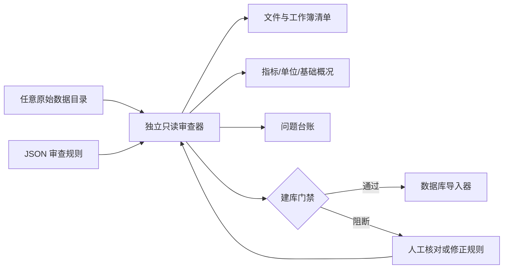

# 独立源数据审查器设计

## 一句话职责

在任何数据库写入发生之前，只读扫描一批历史饲料原料工作簿，给出可定位、可归责、可机器判定的建库门禁。

## 设计原则

1. **先审查，后建库。** 审查器不能通过创建临时 SQLite 来判断 Excel 是否正确。
2. **源目录只读。** 报告目录必须位于源目录之外；工具不保存、重命名、删除或修正源文件。
3. **证据定位。** 每个问题尽量保留工作簿、sheet、单元格、原始指标和值。
4. **不自动纠错。** 小数点、单位和列位异常只能定位，必须依据原文或作者记录确认。
5. **身份规则明确。** title 必填，DOI 可空；有 DOI 时做规范化去重，无 DOI 时按规范化题目去重。
6. **编号不被误当主键。** 原料编号可在不同试验或处理中重复，导入器必须结合来源列和试验语境建立身份。
7. **结构不等于单位。** AID、SID、ATTD、STTD 是测量语境，不自动等于百分比；单位不明时不能凭数值大小改写。
8. **版权最小化。** PDF 只清点，不解析、不复制进公开包；公开数据以题目、DOI/引文指向来源。
9. **不用文件哈希。** 版本和审查轮次以目录、文件名、日期和报告内容管理。

## 责任边界

| 归属 | 含义 | 例子 |
|---|---|---|
| `SOURCE_EXCEL` | 原始整理表本身需要核对 | 缺题目、Excel 错误值、明确的 MJ/kg 万级错误 |
| `IMPORTER_RULE` | 源信息需要被导入器正确解释 | 指标名中嵌入单位、原料编号跨处理重复 |
| `DATABASE_QC` | 数据入库后的通用一致性约束 | 外键、唯一性、状态与数值域联动 |
| `MANUAL_REVIEW` | 自动规则不足以断言对错 | 极端处理效应与小数点错误的区分 |

## 门禁语义

- `BLOCKER`：证据足以阻止建库，例如重复来源身份或能量行混合千倍量级。
- `ERROR`：明确违反已知结构或单位约束，同样阻止建库。
- `WARNING`：需要处理或解释，但不单独阻止建库。
- `INFO`：给导入器或数据管理者的规则提示。

`release_gate.json` 是数据库构建程序唯一需要读取的前置结果。只有 `can_build_database=true` 才能继续。审查器本身不调用数据库构建程序，数据库构建程序也不得自行忽略门禁。

## 扩展方式

- 在 `default_rules.json` 中增加 sheet 别名、章节名、单位和基础词形。
- 在 `auditor.py` 中增加新的检查器时，必须给出稳定的 `code`、严重性、责任归属、证据和建议动作。
- 新规则先在 `test_auditor.py` 中加入合成工作簿回归测试，再运行真实数据。
- 面向其他数据项目时，可替换规则 JSON；核心输出契约保持不变。
